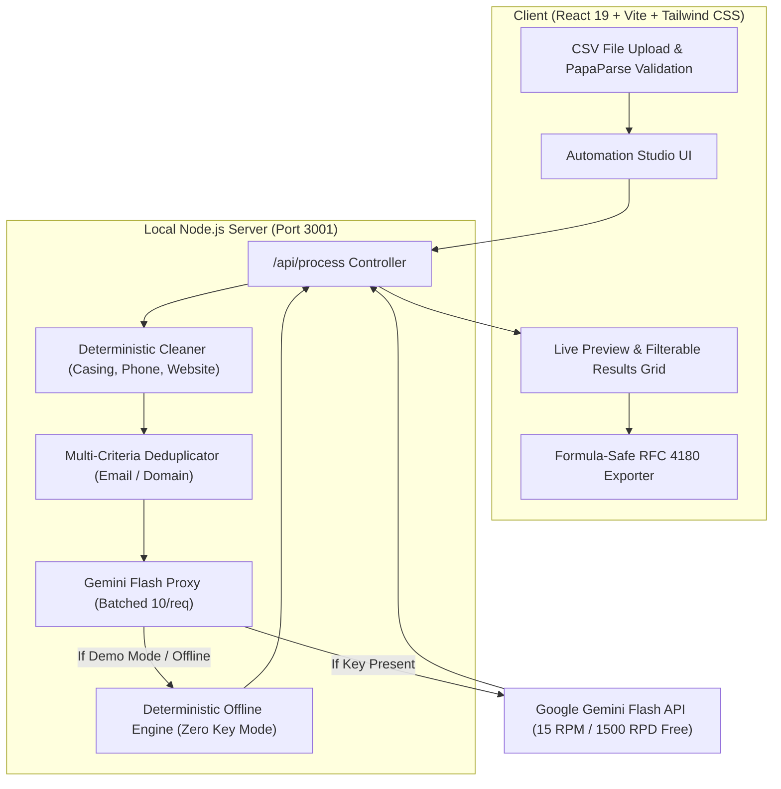

# FlowPilot AI — Free-Tier AI Business Automation Studio

> **Portfolio-Grade B2B Lead Intelligence, Deduplication & Outreach Automation Platform**  
> *Built with React, Vite, TypeScript, Tailwind CSS, Express, and Google Gemini Flash API.*

---

## 🎯 Executive Overview

**FlowPilot AI** solves one of the most persistent bottlenecks for B2B outbound agencies, sales development teams (SDRs), and recruiters: **dirty, unstructured lead data**.

Raw scrapes from Apollo, LinkedIn, and Google Maps are routinely cluttered with:
- Inconsistent casing (`JOHN DOE`, `sarah smith`)
- Fractured phone formatting (`5550192834`, `(555) 019-2834`, `+1 555-019-2834`)
- Broken URLs and missing protocols
- Costly duplicate records across multiple contact email addresses and corporate domains
- Zero contextual outreach hooks

FlowPilot AI executes a **hybrid local + AI architecture**:
1. **100% Free Local Deterministic Engine**: Runs data cleaning, schema auto-mapping, phone/URL normalization, and multi-strategy deduplication locally on your Mac with **\$0.00 API expenses**.
2. **Context-Aware AI Enrichment**: Leverages **Google Gemini Flash Free Tier** (or local deterministic Mock Mode) to classify leads into Decision Maker Tiers (A/B/C) and draft tailored 1-sentence personalized outreach icebreakers.
3. **Enterprise Spreadsheet Security**: Automatically prevents **CSV Formula Injection (CWE-1236)** by neutralizing dangerous trigger characters (`=`, `+`, `-`, `@`) upon export.

---

## 💼 Fiverr Commercial Service Playbook

You can immediately package FlowPilot AI into a high-demand service on Fiverr or Upwork:

### Suggested Fiverr Gig Title
> *"I will clean, deduplicate, and AI-enrich your B2B lead list for cold outreach"*

### Recommended Pricing Packages

| Package | Scope | Price | Your Cost | Net Profit | Turnaround |
| :--- | :--- | :--- | :--- | :--- | :--- |
| **Basic** | Clean, format & deduplicate up to **500 leads** (Phone, URL, Casing fixes) | **\$20** | **\$0.00** (Local TS engine) | **\$20** | 24 Hours |
| **Standard** | Clean + Dedupe + **ICP Tiering (A/B/C)** for up to **1,000 leads** | **\$45** | **\$0.00** (Gemini Flash Free Tier) | **\$45** | 24 Hours |
| **Premium** | Clean + Dedupe + ICP Tiering + **Personalized 1-Line AI Hooks** for up to **2,500 leads** | **\$85** | **\$0.00** (Batched Gemini Flash) | **\$85** | 48 Hours |

---

## 📹 60-Second Video Demo Script (For Portfolio & Fiverr Video)

Record your screen using Loom or QuickTime Player using this script:

- **0:00 – 0:10 (The Problem)**:  
  *"If you buy lead lists from Apollo or LinkedIn, half your budget gets wasted on duplicate domains, invalid phone numbers, and generic cold emails that get marked as spam."*
- **0:10 – 0:25 (The Ingestion & Cleaning)**:  
  *"Watch FlowPilot AI in action. I'm dropping in a messy raw CSV with mixed casing, duplicate records, and raw phone numbers. In one click, our engine normalizes all contact fields and strips out duplicate company domains."*
- **0:25 – 0:45 (The AI Intelligence)**:  
  *"Next, FlowPilot automatically categorizes every prospect into Tier A, B, or C decision-maker buckets and drafts a hyper-personalized 1-line icebreaker tailored to their role and company momentum."*
- **0:45 – 1:00 (The Deliverable & Call to Action)**:  
  *"The result is a clean, formula-injection-safe CSV ready to upload directly into Instantly, Smartlead, or HubSpot. Send me your list today and get your cleaned deliverable within 24 hours."*

---

## 🛠️ Architecture & Free-Tier Stack



| Component | Free-Tier Technology | Quotas / Limits | Commercial / Privacy Rules |
| :--- | :--- | :--- | :--- |
| **Frontend** | React 19, Vite, Tailwind CSS | Unlimited Local / $0 | MIT License |
| **Data Parsing** | PapaParse + TypeScript | Unlimited Local / $0 | Client-side streaming |
| **Backend Proxy** | Express.js + TypeScript | Unlimited Local / $0 | Protects API secrets from client bundle |
| **AI Engine** | Google Gemini 2.0 / 1.5 Flash | **15 RPM / 1,500 RPD / 1M TPM** (Free) | Free tier logs prompts for Google training. FlowPilot provides **Offline Demo Mode** for confidential data. |
| **Security** | CWE-1236 Formula Sanitizer | Neutralizes `=`, `+`, `-`, `@` triggers | Prevents malicious spreadsheet execution |

---

## 🚀 Quickstart Guide

### Prerequisites
- Node.js `v20+` or `v26+`
- npm `10+` or `11+`

### 1. Clone & Install
```bash
# Navigate to directory
cd FlowPilot_AI

# Install all dependencies (root, client, server)
npm install
npm run install:all
```

### 2. Environment Configuration (Optional)
To use live Google Gemini Flash:
1. Get a free API key at [Google AI Studio](https://aistudio.google.com/app/apikey).
2. Copy `.env.example` to `.env`:
   ```bash
   cp .env.example server/.env
   ```
3. Add your key:
   ```env
   GEMINI_API_KEY=your_key_here
   ```
*(Note: If no key is provided, FlowPilot AI automatically runs in 100% Free Offline Demo Mode).*

### 3. Start Development Studio
Run both frontend and backend concurrently with one command:
```bash
npm run dev
```

- **Frontend Studio UI**: `http://localhost:5173`
- **Backend API Server**: `http://localhost:3001`
- **Server Health Check**: `http://localhost:3001/api/health`

### 4. Run Automated Test Suite
FlowPilot AI features **39 automated tests** covering cleaning, normalization, deduplication, formula sanitization, and integration resilience:
```bash
npm run test
```

---

## 🔒 Security & Privacy Guarantees

1. **Zero Secret Leaks**: The `GEMINI_API_KEY` is never bundled into client JavaScript. All requests route through the local Node.js proxy.
2. **Formula Injection Neutralization**: Any exported cell starting with `=`, `+`, `-`, `@`, `\t`, or `\r` is automatically prefixed with `'` to render as literal text in Microsoft Excel and Google Sheets.
3. **Data Privacy Guard**: The studio clearly discloses when external AI APIs are being invoked versus when data is processed purely offline.

---

## 📄 License
MIT License. Built for commercial client delivery and portfolio demonstrations.

